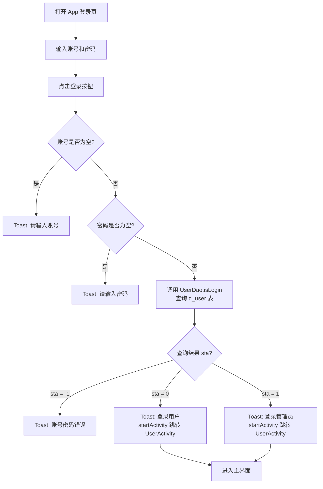
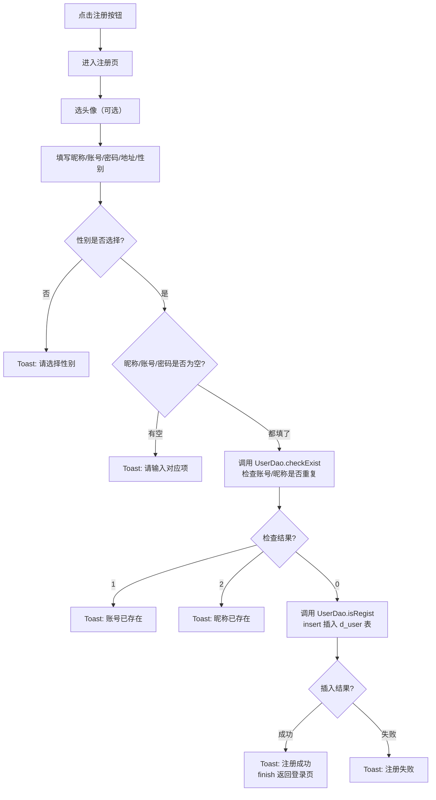
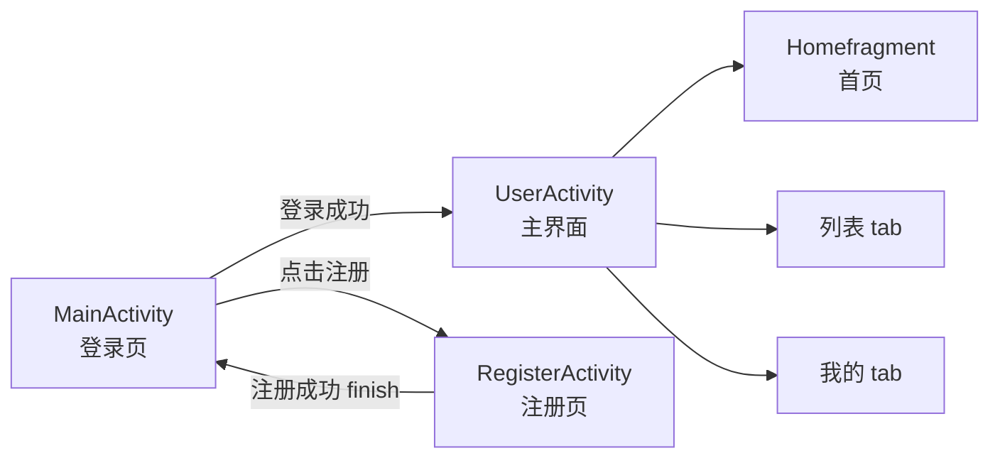

# MusicStar 音乐 App 开发笔记

> 这份笔记记录项目框架搭建、登录/注册功能、数据库与界面实现，以及开发过程中踩过的 bug。
> 项目路径：`D:\musicstar4`

---

## 一、项目技术栈与框架搭建

### 1.1 基本信息

| 项目 | 说明 |
|---|---|
| 语言 | Java（UI 层）+ 预留 C++（NDK/JNI，暂未使用） |
| 构建工具 | Gradle（Kotlin DSL，`build.gradle.kts`） |
| 最低 SDK | minSdk = 24（Android 7.0） |
| 目标/编译 SDK | targetSdk = 37 |
| 包名 / namespace | `com.example.music_star` |
| UI 主题 | Material3（`Theme.Material3.DayNight.NoActionBar`） |

### 1.2 关键依赖（`gradle/libs.versions.toml`）

```toml
material = "1.10.0"        # Material 组件库（BottomNavigationView 等来自这里）
appcompat = "1.6.1"        # AppCompatActivity
activityKtx = "1.8.0"
constraintlayout = "2.1.4"
```

> ⚠️ **注意 Material 版本**：本项目的 Material 是 **1.10.0**，不是最新的。
> 有些属性在新版本才有，旧版本没有，用错了会报「resource linking failed」（详见 bug 4）。

### 1.3 项目目录结构

```
app/src/main/
├── AndroidManifest.xml              # 注册 Activity（很重要，忘了注册会崩）
├── java/com/example/music_star/
│   ├── MainActivity.java            # 登录界面
│   ├── activity/
│   │   ├── RegisterActivity.java    # 注册界面
│   │   └── yonghu/
│   │       ├── UserActivity.java    # 登录后的主界面（底部导航）
│   │       └── fragment/
│   │           └── Homefragment.java # 首页 Fragment
│   ├── adapter_user/
│   │   └── PlayMusicAdapter.java    # 音乐列表 RecyclerView 适配器（空壳）
│   ├── bean/
│   │   └── PlayMusicBean.java       # 音乐实体类
│   ├── dao/
│   │   ├── UserDao.java             # 用户登录/注册的数据库操作
│   │   └── PalymusicDao.java        # 查询音乐（空壳，待写）
│   └── until/
│       ├── DBuntil.java             # 数据库（SQLiteOpenHelper）
│       └── tools.java               # 弹 Toast 工具类
├── res/
│   ├── layout/                      # 布局
│   │   ├── activity_main.xml        # 登录页布局
│   │   ├── activity_register.xml    # 注册页布局
│   │   ├── activity_user.xml        # 主界面布局（底部导航容器）
│   │   └── frame_user_home.xml      # 首页 Fragment 布局
│   ├── menu/
│   │   └── menu_user_bottom_menu.xml # 底部导航菜单
│   ├── values/                      # colors.xml、themes.xml、strings.xml
│   └── drawable/                    # 图标、背景图
└── cpp/                             # C++（NDK，预留）
    ├── CMakeLists.txt
    └── music_star.cpp
```

---

## 二、数据库设计

数据库类在 `until/DBuntil.java`，继承 `SQLiteOpenHelper`。

### 2.1 核心代码骨架

```java
public class DBuntil extends SQLiteOpenHelper {
    private static final int version = 5;           // 改表结构必须 +1，否则不生效
    private static final String databaseName = "db_takeaway.db";
    public static SQLiteDatabase con;               // 全局连接，供所有 DAO 使用

    public DBuntil(Context context) {
        super(context, databaseName, null, version, null);
    }

    @Override
    public void onCreate(SQLiteDatabase db) {
        // 建表 + 插入初始数据
    }

    @Override
    public void onUpgrade(SQLiteDatabase db, int oldVersion, int newVersion) {
        // 版本升级时重建表
    }
}
```

### 2.2 数据表

**用户表 `d_user`**：

| 字段 | 类型 | 说明 |
|---|---|---|
| account | varchar(20) PK | 账号（主键） |
| nickname | varchar(50) | 昵称 |
| pwd | varchar(50) | 密码 |
| img | varchar(50) | 头像 |
| pow | varchar(50) | 权限（0=用户，1=管理员） |
| address | varchar(50) | 地址 |
| sex | varchar(50) | 性别 |
| listening_time | INTEGER | 听歌时长 |
| song_count | INTEGER | 曲数 |
| registration_time | DATETIME | 注册时间 |

**歌单表 `d_sheet`**：

| 字段 | 说明 |
|---|---|
| id | 歌单 ID（主键） |
| name | 歌单名 |
| img | 封面 |
| create_user_id | 创建用户 ID |
| sta | 可见性（0 只能自己见） |
| create_time | 创建时间 |

### 2.3 数据库初始化时做的事

1. 建 `d_user` 表，并插入两个默认账号：
   - `root / 123456`（管理员 pow=1，昵称"小寒"）
   - `xx / 123456`（普通用户 pow=0，昵称"小欣"）
2. 建 `d_sheet` 表，插入两条歌单数据。

### 2.4 如何在 Activity 里初始化数据库

在 `MainActivity.onCreate()` 里（必须在任何 DAO 操作之前）：

```java
DBuntil dbUtil = new DBuntil(this);          // 创建对象，触发建表
DBuntil.con = dbUtil.getWritableDatabase();  // 拿到连接，赋给静态变量
```

之后所有 DAO 都用 `DBuntil.con` 来查库。

---

## 三、登录功能实现

### 3.1 流程

用户点「登录」按钮 → 校验输入 → 查数据库 → 成功则跳转到主界面。

### 3.2 数据库查询（`UserDao.isLogin`）

```java
public static int isLogin(String account, String pwd) {
    String sql = "select * from d_user where account=? and pwd=?";
    Cursor result = DBuntil.con.rawQuery(sql, new String[]{account, pwd});
    try {
        if (result.moveToNext()) {
            int pow = result.getInt(result.getColumnIndex("pow"));
            return pow; // 0=用户 1=管理员
        }
    } finally {
        result.close();   // ⚠️ 必须 close，否则内存泄漏
    }
    return -1; // 账号或密码错误
}
```

### 3.3 登录按钮逻辑（`MainActivity`）

```java
btnlogin.setOnClickListener(v -> {
    String account = accountT.getText().toString();
    String pwd = pwdT.getText().toString();

    if (account.isEmpty()) {
        tools.Toast(MainActivity.this, "请输入账号");
    } else if (pwd.isEmpty()) {
        tools.Toast(MainActivity.this, "请输入密码");
    } else {
        int sta = UserDao.isLogin(account, pwd);
        if (sta == -1) {
            tools.Toast(MainActivity.this, "账号密码错误");
        } else {
            // 登录成功 → 跳转到主界面
            startActivity(new Intent(MainActivity.this, UserActivity.class));
        }
    }
});
```

> ⚠️ **重点**：登录成功后**必须调用 `startActivity`** 才能真正跳转，光弹 Toast 是跳不过去的（这是当初的 bug，见 bug 3）。

---

## 四、注册功能实现

### 4.1 流程

选头像（可选）→ 填昵称/账号/密码/地址/性别 → 校验 → 检查是否重复 → 插入数据库 → 成功返回登录页。

### 4.2 数据库操作（`UserDao`）

**检查账号/昵称是否已存在**：

```java
public static int checkExist(String account, String nickname) {
    // 返回：0=都不存在，1=账号已存在，2=昵称已存在
    String sql = "select account,nickname from d_user where account=? or nickname=?";
    Cursor result = DBuntil.con.rawQuery(sql, new String[]{account, nickname});
    try {
        while (result.moveToNext()) {
            if (account.equals(result.getString(result.getColumnIndex("account")))) return 1;
            if (nickname.equals(result.getString(result.getColumnIndex("nickname")))) return 2;
        }
    } finally {
        result.close();
    }
    return 0;
}
```

**插入新用户**：

```java
public static int isRegist(String nc, String account, String pwd, String dizhi, String sex, String img) {
    // ⚠️ 插入必须用 execSQL，不能用 rawQuery
    String sql = "insert into d_user(account,nickname,pwd,img,pow,address,sex) values(?,?,?,?,?,?,?)";
    try {
        DBuntil.con.execSQL(sql, new String[]{account, nc, pwd, img, "0", dizhi, sex});
        return 1;
    } catch (Exception e) {
        return -1;
    }
}
```

### 4.3 头像选择（`RegisterActivity`）

用系统图片选择器，关键是 **`registerForActivityResult` 必须在 `onCreate` 里注册，不能在点击回调里注册**：

```java
ActivityResultLauncher<String> launcher =
    registerForActivityResult(new ActivityResultContracts.GetContent(), uri -> {
        if (uri != null) {
            tx.setImageURI(uri);
            result = uri;   // 存起来，注册时用
        }
    });

tx.setOnClickListener(v -> launcher.launch("image/*"));  // 点头像触发
```

---

## 五、用户主界面（底部导航 + Fragment）

### 5.1 布局结构（`activity_user.xml`）

```
LinearLayout (vertical)
├── FrameLayout  (id=man_manage_frame, weight=1)   ← Fragment 容器
└── BottomNavigationView (id=user_bottom_menu)      ← 底部导航
```

```xml
<BottomNavigationView
    android:id="@+id/user_bottom_menu"
    android:layout_width="match_parent"
    android:layout_height="wrap_content"
    android:background="#BFEB83C5"
    app:itemIconTint="@color/white"
    app:itemTextColor="#F2EDF0"
    app:itemActiveIndicatorStyle="@null"   <!-- 关掉灰色选中底 -->
    app:menu="@menu/menu_user_bottom_menu" />
```

### 5.2 底部菜单（`menu/menu_user_bottom_menu.xml`）

```xml
<menu ...>
    <item android:id="@+id/user_bottom_menu" android:title="首页" android:icon="@drawable/music" app:showAsAction="always"/>
    <item android:id="@+id/user_bottom_list" android:title="列表" android:icon="@drawable/list" app:showAsAction="always"/>
    <item android:id="@+id/user_bottom_my"   android:title="我的" android:icon="@drawable/my" app:showAsAction="always"/>
</menu>
```

### 5.3 Fragment 切换（`UserActivity`）

所有 Fragment 操作都要在 `onCreate` 内，放在 `setContentView` 之后：

```java
protected void onCreate(Bundle savedInstanceState) {
    super.onCreate(savedInstanceState);
    EdgeToEdge.enable(this);
    setContentView(R.layout.activity_user);

    FragmentManager fm = getSupportFragmentManager();
    FragmentTransaction tx = fm.beginTransaction();
    tx.replace(R.id.man_manage_frame, new Homefragment());
    tx.commit();
}
```

### 5.4 首页 Fragment（`Homefragment`）

```java
public class Homefragment extends Fragment {
    @Nullable
    @Override
    public View onCreateView(@NonNull LayoutInflater inflater, @Nullable ViewGroup container,
                             @Nullable Bundle savedInstanceState) {
        return inflater.inflate(R.layout.frame_user_home, container, false);
    }
}
```

---

## 六、AndroidManifest 注册

每个新 Activity 都要在 `AndroidManifest.xml` 里注册，否则启动时崩（`ActivityNotFoundException`）。

```xml
<activity android:name=".MainActivity" android:exported="true" ...>  <!-- 启动页 -->
    <intent-filter>
        <action android:name="android.intent.action.MAIN" />
        <category android:name="android.intent.category.LAUNCHER" />
    </intent-filter>
</activity>
<activity android:name=".activity.RegisterActivity" android:exported="false" ... />
<activity android:name=".activity.yonghu.UserActivity" android:exported="false" ... />
```

> 说明：只有启动页（有 LAUNCHER）需要 `exported="true"`，其余都是 `false`。

---

## 七、C++（NDK/JNI）——预留，暂未使用

项目已配好 CMake（`build.gradle.kts` 里有 `externalNativeBuild`），`cpp/music_star.cpp` 是空的。

### 结论（重要）

- **「查找音乐」这类数据库 CRUD 不要用 C++**。数据库连接 `DBuntil.con` 在 Java 侧，C++ 查库要跨 JNI 传连接、传结果对象，反而更麻烦，且没有性能收益。
- **C++ + JNI 只适合**：音视频解码/播放、信号处理、加解密、性能敏感计算、复用现成 C++ 库。
- Java 和 C++ 类不能直接互通，必须通过 JNI 桥接（Java 声明 `native` 方法，C++ 写 `JNIEXPORT` 函数）。

---

## 八、踩过的 Bug 记录（重点）

### Bug 1：底部导航「首页」图标有灰色背景，其他没有

**现象**：首页图标有个灰色圆角胶囊背景，列表/我的没有。

**原因**：Material3 的 `BottomNavigationView` 默认对「选中项」加了一个 active indicator（选中指示器）。首页是第一个菜单项，默认被选中，所以只有它有灰底。点别的 tab 灰底会跟着跑。

**解决**：关掉它。

### Bug 2：`itemActiveIndicatorEnabled` 属性报错「not found」

**现象**：`resource linking failed: attribute itemActiveIndicatorEnabled not found`

**原因**：本项目 Material 是 1.10.0，这个版本**没有** `itemActiveIndicatorEnabled` 属性。

**正确写法**：用 `itemActiveIndicatorStyle` 指向 `@null`：

```xml
app:itemActiveIndicatorStyle="@null"
```

**教训**：Material 属性名会随版本变化，不确定时先查自己用的版本的 `attrs`，别直接套网上的写法。

### Bug 3：点登录不跳转

**现象**：账号密码正确，弹了「登录用户」的 Toast，但一直停在登录页。

**原因**：登录成功分支里只写了 `tools.Toast(...)`，**没有调用 `startActivity`**。跳转必须显式调用。

**解决**：在成功分支加 `startActivity(new Intent(MainActivity.this, UserActivity.class));`

### Bug 4：`UserActivity.java` 报「需要标识符 / 非法的类型开始」

**现象**：`transaction.replace(...)` 和 `transaction.commit()` 等报错。

**原因**：Fragment 相关代码**写在了类体里（方法外面）**，还多了一个 `}`，import 也写重复了。`findViewById`、`getSupportFragmentManager()` 这些方法调用只能写在方法内部。

**解决**：把 Fragment 代码全部挪进 `onCreate` 方法里，删掉多余的 `}`，修好 import。

### Bug 5：`PlayMusic.java` 报「进行语法分析时已到达文件结尾」

**现象**：编译报 `reached end of file while parsing`。

**原因**（三个问题叠加）：
1. 花括号不配对——外层类缺一个 `}`；
2. 类名 `PlayMusicAdapter` 和文件名 `PlayMusic.java` 不一致（Java 要求 public 类名 = 文件名）；
3. `viewHolder extends RecyclerView.ViewHolder` 没写构造方法（ViewHolder 必须 `super(itemView)`）。

**解决**：新建正确命名的 `PlayMusicAdapter.java`，补上 viewHolder 构造方法，删掉旧的 `PlayMusic.java`。

### Bug 6（✅ 已解决）：`DBuntil.java` 引用了不存在的 `FileUntil`

**现象**：`DBuntil.java` 第 59 行：

```java
String txPathU = FileUntil.saveDrawableToFileSaveAs(context, R.drawable.track);
```

但项目里**没有 `FileUntil` 这个类**，编译会报「找不到符号 FileUntil」。

**解决**：新建 `until/FileUntil.java`，实现 `saveDrawableToFileSaveAs(Context, int drawableId)`——把 drawable 资源转成 PNG 存到 App 私有目录（`context.getFilesDir()`），返回文件绝对路径。要点：
- 存私有目录，**无需申请存储权限**；
- `BitmapDrawable` 直接取 Bitmap，其他类型用 `Canvas` 手动绘制转换；
- 失败返回空字符串，不抛异常。

---

## 九、常见 Java 易错点总结

1. **方法调用必须写在方法里**，不能写在类体（类的大括号内、方法外）。
2. **public 类的类名必须和文件名一致**（`public class Xxx` 必须放在 `Xxx.java`）。
3. **大括号要配对**：每写一个 `{` 就要有对应的 `}`，注意嵌套层级。
4. **`Cursor` 用完必须 `close()`**，用 `try/finally` 保证。
5. **查数据库用 `rawQuery`，增删改用 `execSQL`**。
6. **改表结构要 `version + 1`**，否则 `onCreate` 不会重新执行。
7. **新 Activity 要在 Manifest 注册**。
8. **`registerForActivityResult` 必须在 `onCreate` 里注册**。
9. **字符串判空用 `.isEmpty()` 或 `TextUtils.isEmpty()`**，判断相等用 `.equals()` 而不是 `==`。

---

## 十、下一步待办

- [x] 补写 `until/FileUntil.java`（Bug 6）
- [ ] 补全 `PalymusicDao`（查音乐 DAO）
- [ ] 补全 `PlayMusicAdapter`（列表适配器：onCreateViewHolder 返回真实 view、绑定数据、传数据源）
- [ ] 实现底部导航三个 tab 的点击切换（`setOnItemSelectedListener`）
- [ ] 首页 SearchView 搜索音乐的查询逻辑

---

## 十一、流程图（Mermaid）

> 直接粘到支持 Mermaid 的 Markdown 编辑器里即可渲染。

### 11.1 登录流程



### 11.2 注册流程



### 11.3 页面跳转关系


